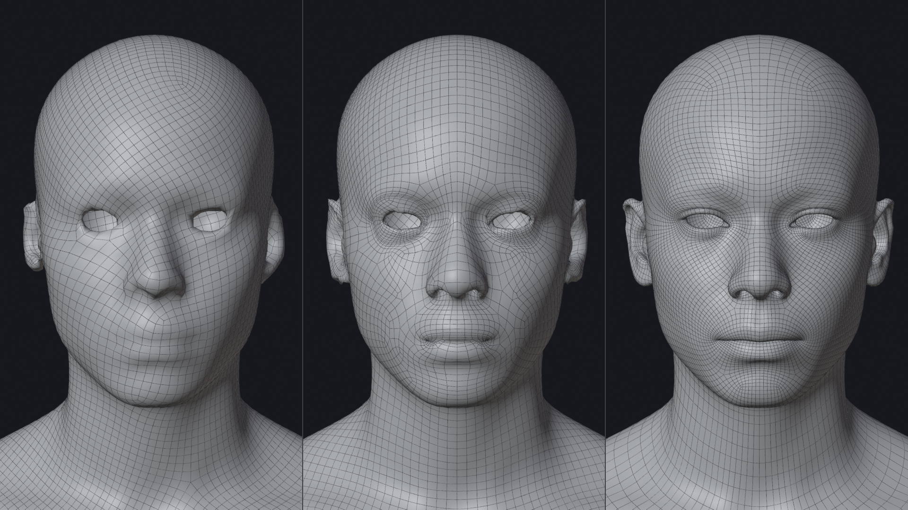

# FlowTopo

Animation-ready retopology for Blender. Muse Spark plans the edge loops, SAM 3.1 finds the features, and a quad remesher builds topology that deforms cleanly around the eyes and mouth.

AI 3D generators and scanners output meshes as triangle soup. Automatic remeshers turn these into even quad grids, but animation needs edge loops: concentric rings around the eyes and mouth, and rings around the limbs. A character artist usually draws these by hand. FlowTopo places them automatically.



## How it works

```
mesh ──► 10 grey renders ──► Muse Spark 1.3 (vision, structured output)
                              "realistic human head: eyes = concentric, 3 rings; mouth = concentric, 3 rings; ..."
                                     │
                                     ▼
                        SAM 3.1 per feature, per view ("eye", "mouth", "ear" ...)
                        (full bodies: SAM finds the "head" first, then face features in head close-ups)
                                     │  masks back-projected onto mesh faces
                                     ▼  (BVH visibility + multi-view voting + morphological clean-up)
                        semantic regions on the mesh
                                     │  distance field per region, geodesic Voronoi so rings never cross
                                     ▼
                        exact isoline cuts = guide rings (marked as seams)
                                     │
                                     ▼
                        QRemeshify / QuadWild: quads that follow the guides, then a relax pass
                                     │
                                     ▼
                        Muse Spark reviews the wireframe ──► new plan ──► second pass, kept only if it scores higher
```

- Muse Spark 1.3 looks at the renders and decides which features need loops and how many rings each gets. It returns structured JSON with a reason for each choice. After the remesh it reviews the wireframe, scores it and can propose a new plan. FlowTopo runs that plan and keeps it only if the eyes-and-mouth score improves.
- SAM 3.1 (text-prompted segmentation) finds each feature on plain, untextured grey renders. FlowTopo projects the masks back onto the mesh with ray-cast visibility and votes across views. On a full body the face is only a few pixels wide, so SAM finds the head first and FlowTopo renders close-ups of it for the face features.
- FlowTopo turns the regions into guide rings by cutting the mesh along distance-field isolines. A geodesic Voronoi partition keeps the rings of neighbouring features from crossing.
- QRemeshify ([QuadWild](https://github.com/nicopietroni/quadwild) inside Blender) treats the rings as feature lines and builds quads along them.

## Results

The metric is the share of quad edges in each feature's ring zone that run along a ring or a spoke, within 15°. A random grid scores 33.3% and perfect concentric topology scores 100%. The full table, including bodies and a hand, is in [eval/EVAL.md](eval/EVAL.md).

Eyes and mouth, where a face deforms most. Muse Spark planned and reviewed every run.

| Mesh | FlowTopo | QRemeshify (no guides) | QuadriFlow | Artist's own topology |
|---|---|---|---|---|
| Blender Studio realistic head | **45.3%** | 40.5% | 38.1% | 41.7% |
| Blender Studio sculpt head | **43.0%** | 38.8% | 34.4% | 42.4% |
| Blender Studio low-poly head | **40.2%** | 32.1% | 33.0% | 52.7% |
| Lee Perry-Smith head scan | **36.9%** | 32.7% | 32.4% | - |
| Suzanne (creature, no template) | **45.9%** | 33.0% | 34.5% | - |
| Stylised male body | **41.3%** | 35.5% | 38.6% | 47.9% |
| Stylised female body | **42.2%** | 34.1% | 37.4% | 47.3% |
| Realistic female body (face found in head close-ups) | **45.1%** | 41.1% | 27.8% | 42.9% |
| **Average (8 meshes)** | **42.5%** | 36.0% | 34.5% | |

All three remeshed versions get the same relax pass, which evens out the quads and snaps them back onto the surface. The comparison is like for like.

- The plain remeshers score only slightly above a random grid. On eyes and mouth FlowTopo beats both on all 8 meshes. Across all features (eval/EVAL.md) it beats both on 8 of 9. On the stylised male body QuadriFlow is 0.7 points ahead.
- Six of the meshes ship with an artist's hand-made topology. On these, FlowTopo closes about 70% of the gap between QuadriFlow and the artist, and scores above the artist on 3 of them.

A head takes about a minute in Blender. Retopologising a head by hand takes hours: about 3-4 h for a simple head and days for a production head, according to artists on [polycount](https://polycount.com/discussion/comment/1060768) and [BlenderNation](https://www.blendernation.com/2015/02/07/mechanical-elephant/).

Meta API calls cost about $0.05-0.10 per head and up to about $0.50 for a full body with many features (SAM $0.0025 per image, Spark about $0.01 per call). Every response is cached, so reruns are free.

## Install (Blender 4.2+)

1. Install QRemeshify (free, GPL): Edit > Preferences > Get Extensions, or from [github.com/ksami/QRemeshify](https://github.com/ksami/QRemeshify/releases).
2. Install FlowTopo: Edit > Preferences > Add-ons > Install from Disk > `dist/flowtopo-0.1.0.zip`.
3. In the FlowTopo preferences, paste your Meta Model API key from [dev.meta.ai](https://dev.meta.ai). A spend cap is built in (default $38).
4. Select a mesh and open the sidebar (N) > FlowTopo > Retopologise.

The panel shows live progress, Muse Spark's loop plan with its reasons, Spark's review, the alignment score and the API cost of the run. "Compare with original" switches between input and result.

## Running headless and reproducing the eval

```
blender --background --python scripts/prep_assets.py      # builds the eval meshes (needs the CC0 base-mesh bundle)
py scripts/eval_all.py --tag eval3                         # FlowTopo + baselines on 9 meshes -> eval/EVAL.md
blender --background out/runs/<mesh>_eval3/scene.blend --python scripts/make_demo.py -- <mesh> eval3
blender --background out/runs/<mesh>_eval3/scene.blend --python scripts/render_loops.py -- <mesh> eval3
blender --factory-startup --window-fullscreen --enable-event-simulate out/ui_capture/start.blend --python scripts/capture_ui.py -- <mesh>
blender --background --factory-startup --python scripts/build_video.py -- head_realistic lee_scan suzanne
```

`capture_ui.py` records the add-on running in the Blender UI (window screenshots during a run) for the demo video.

Set `MODEL_API_KEY` in the environment or in `.env`, which is not committed.

## Repository

| Path | What |
|---|---|
| `flowtopo/` | The Blender extension (also importable headless) |
| `flowtopo/api.py` | Meta Model API client: disk cache, cost log, hard budget |
| `flowtopo/sam.py`, `sam_codec.py` | SAM 3.1 calls and mask decoding (codec adapted from Meta's `meta-sam-parser`, SAM License) |
| `flowtopo/plan.py` | Muse Spark inventory and critique prompts and schemas |
| `flowtopo/core.py` | Back-projection, voting, regions, distance fields |
| `flowtopo/guides.py` | Exact isoline cutting, Voronoi-guarded rings |
| `flowtopo/metrics.py` | Edge-flow alignment, irregular vertices, fidelity |
| `flowtopo/loops.py` | The Alt+click test: closed edge loops around a feature |
| `scripts/` | Eval set prep, eval runner, demo renders, video assembly |

## Limitations

- Faces work best. On full bodies the limb rings run up from the hands and feet, and the eyes are only a few quads wide. Joint loops for elbows and knees are not implemented yet.
- FlowTopo usually produces one closed edge loop around each eye and the mouth. Plain remeshers produce none, and artists place 10-16. QuadWild keeps quads the same size, so it inserts poles between rings of different radius to change the edge count, and each pole breaks a loop. Closed-only guides, smoother fields and QuadWild's regularity settings did not add loops. Per-region density, with smaller quads near the feature, is the planned fix.
- Spark's second pass does not always help. On the head scan it raised the eyes-and-mouth score from 35.4% to 36.9%. On other meshes its proposals scored lower and were rejected.
- Complex creatures are slow. On an AI-generated dragon head with horns, teeth and spikes, QuadWild ran for over 30 minutes without finishing, so the dragon is not in the eval.
- The guide rings follow SAM's mask boundary, so a poor mask gives a poor ring. Multi-view voting and Spark's review catch most bad masks, but not all.

## Credits and licences

- FlowTopo: GPL-3.0-or-later (Blender add-on licence).
- SAM mask codec adapted from `meta-sam-parser` 0.1.0, © Meta Platforms, under the SAM License (`flowtopo/LICENSE-SAM.txt`).
- QRemeshify by ksami (GPL-3.0), QuadWild by Pietroni et al.
- Test meshes: *Infinite, 3D Head Scan* by Lee Perry-Smith, CC BY 3.0 (via three.js examples). Blender Studio *Human Base Meshes* v1.4.1, CC0. *Dragonhead*, generated with [Sloyd](https://www.sloyd.ai/free-3d-models/model/dragonhead-5s39xjbw), CC BY 4.0 (an AI-generated mesh, used as generated). Suzanne is Blender's built-in test mesh.

Built during the Meta Global AI Developer Hackathon 2026 (26 Oct - 4 Nov). All code in this repository was written during the event.
